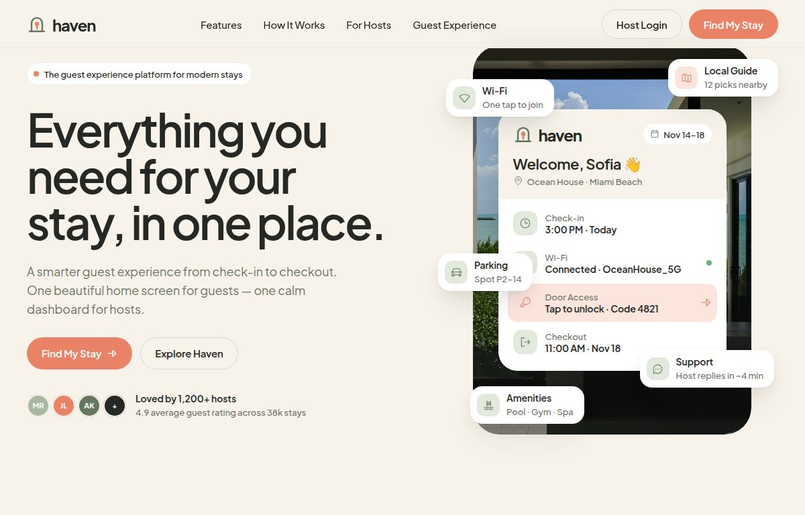
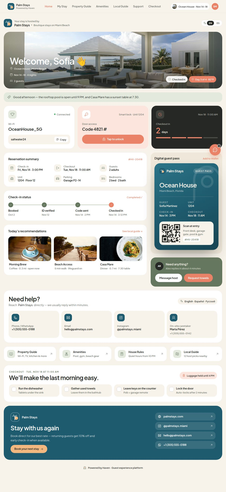
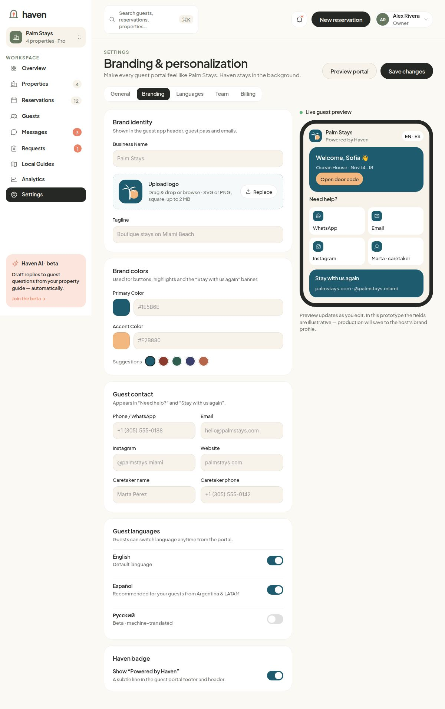

# Haven

**Your stay, all in one place.**

Haven is a digital guest experience platform for short-term rentals, boutique stays, vacation rentals and property managers. Guests get one calm place for reservation details, check-in, Wi-Fi, amenities, local recommendations, support and checkout. Hosts get a separate dashboard to run properties, reservations, guest requests and local guides.

> **Status: v0.2.0-beta.** This is an interactive Framer prototype for design and product validation. No backend, authentication or real data storage yet.



## What's in the prototype

| Page | Path | Notes |
| --- | --- | --- |
| Landing | `/` | Marketing site: guest journey, dashboard preview, contextual "right now" demo, property guide, local guide, support, guest pass, white-label section, hosts, benefits, how it works |
| Find My Stay | `/find-my-stay` | Guest lookup with last name + phone number (no account) |
| Guest Portal | `/guest` | Host-branded portal (Palm Stays): right-now cards, reservation, check-in status, guest pass, Need help?, Stay with us again |
| Amenities | `/amenities` | Pool, gym, bikes, EV charger, Wi-Fi and more, each with a one-tap request |
| Checkout | `/checkout` | Countdown, tap-to-complete checklist, late checkout / luggage / ride extras, review, "I've checked out" |
| Property Guide | `/guide` | Expandable instructions, amenities, safety |
| Local Guide | `/local` | Neighborhood map, host picks, essentials |
| Support | `/support` | Quick actions, tracked requests, chat, emergency info |
| Host Login | `/host-login` | Email, password, remember me |
| Host Dashboard | `/host` | Metrics, arrivals, requests, property performance, messages, automations, "New reservation" form |
| Properties | `/host/properties` | Portfolio grid from the Properties CMS; each card opens a property detail page |
| Property detail | `/host/properties/:slug` | Photo, stats, guest access (rotate door code), next stay |
| Reservations | `/host/reservations` | Table with working status tabs (All / Arriving / In-house / Upcoming / Checked out) |
| Reservation detail | `/host/reservations/:slug` | Stay details, host notes, guest journey timeline, contact, open/resend portal link |
| Guests | `/host/guests` | Guest cards with live search by name |
| Messages | `/host/messages` | Inbox with 4 conversations you can switch between, auto-translation, quick replies, send |
| Requests | `/host/requests` | Kanban board (New / In progress / Done) with Start and Mark done actions |
| Local Guides | `/host/local-guides` | Places CMS with category tabs, Feature toggle, "Add place" modal |
| Analytics | `/host/analytics` | KPIs, monthly revenue (3 / 6 month toggle), occupancy, guest languages, portal engagement |
| Settings · Branding | `/host/settings` | Business name, logo, colors, contact, languages, "Powered by Haven" toggle, live preview |

Every page has Desktop (1200), Tablet (810) and Phone (390) layouts. On phones the guest portal behaves like a native app with a bottom tab bar and a floating chat button.

## Platform model: one Haven, many host brands

Haven is the SaaS platform. Each host or property manager shows guests their **own** brand, with a subtle *Powered by Haven*.

- Host branding is data, not hard-coded design. In Framer it lives in the **Host Brands** CMS collection; see [`data/host-brands.schema.json`](data/host-brands.schema.json) and [`data/host-brands.sample.json`](data/host-brands.sample.json).
- Demo hosts: **Palm Stays** (Miami Beach) and **Casa Sol Rentals** (Cartagena). Both are fictional.
- Guest portal sections that read host data: the hosted-by strip, **Need help?** (Phone/WhatsApp, Email, Instagram, caretaker), **Stay with us again**, and the branded guest pass.

| Palm Stays guest portal | Branding settings |
| --- | --- |
|  |  |

## Languages

Many guests speak Spanish (for example, from Argentina), alongside guests from Canada, Russia and elsewhere.

- **Every page has a Spanish twin** under `/es` (`/es`, `/es/guest`, `/es/guide`, `/es/host/reservations`, …).
- An **EN / ES switch on every page** links straight to that page's counterpart, so switching back and forth is instant in both directions.
- Spanish pages use Spanish CMS fields (property layouts, reservation dates, request titles, place notes) and Spanish copies of the shared components (nav, guest app bar, tab bar, guest pass).
- All UI strings: [`i18n/es-full.json`](i18n/es-full.json) (plus the original [`i18n/en.json`](i18n/en.json) / [`i18n/es.json`](i18n/es.json)).
- Russian appears in settings as a planned "beta" language.

## Design system

- **Colors:** cream, sage, deep sage, charcoal, with coral as the single accent. See [`design/tokens.json`](design/tokens.json).
- **Type:** Plus Jakarta Sans, with responsive text styles.
- **Logo:** a rounded doorway with a keyhole that also reads as a location pin. See [`brand/`](brand).
- **Icons:** Phosphor (thin line).

## Repository layout

```
brand/      Haven and demo-host logos (SVG)
data/       Host brand schema and sample data
design/     Design tokens
docs/       Screenshots
i18n/       English and Spanish UI strings
VERSION     Current version (0.1.0-beta)
CHANGELOG.md
```

The design source itself lives in Framer: https://framer.com/projects/RuIZ5kkZaTiHvPQYrEGL

## Out of scope for v0.1

- Real authentication, verification and database storage (forms and settings are visual only)
- Channel integrations (Airbnb, Vrbo, Booking.com and similar)
- Per-host theming across the entire portal. Today brand colors apply to host-specific elements.

See [CHANGELOG.md](CHANGELOG.md) for details.
